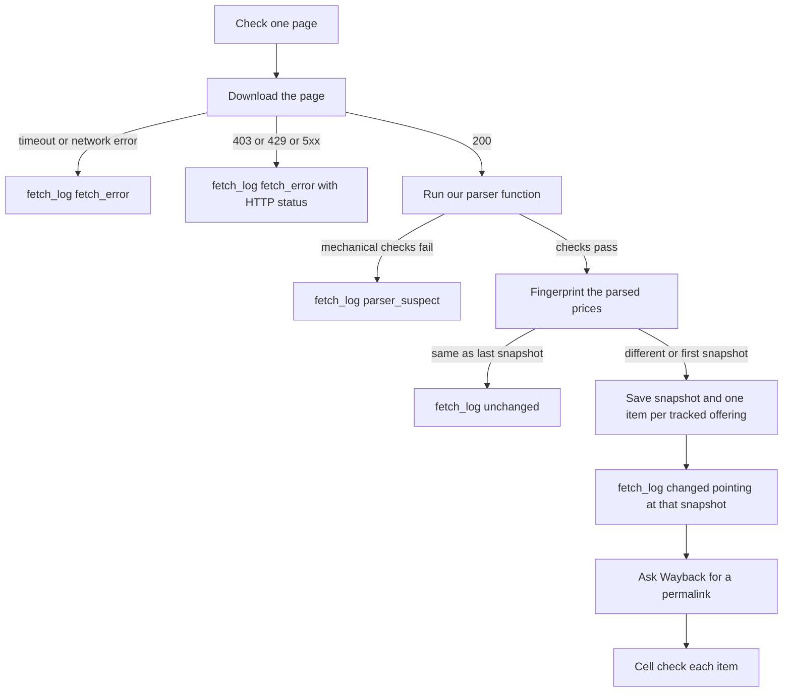
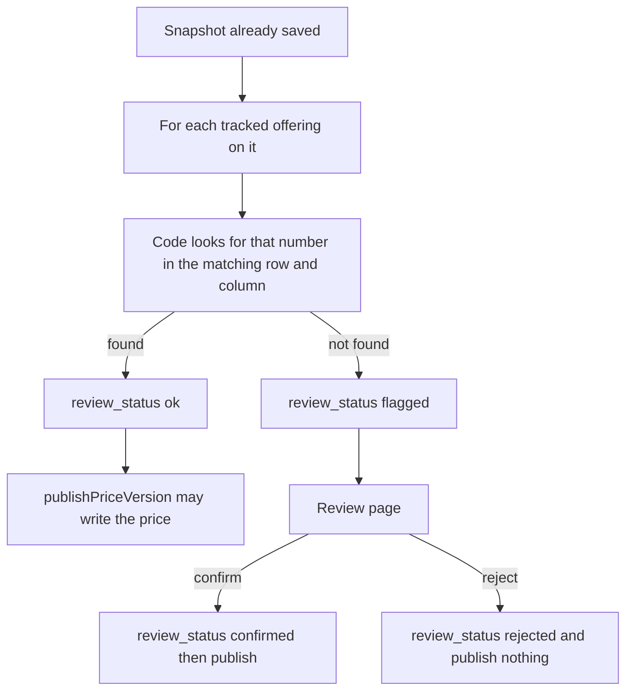
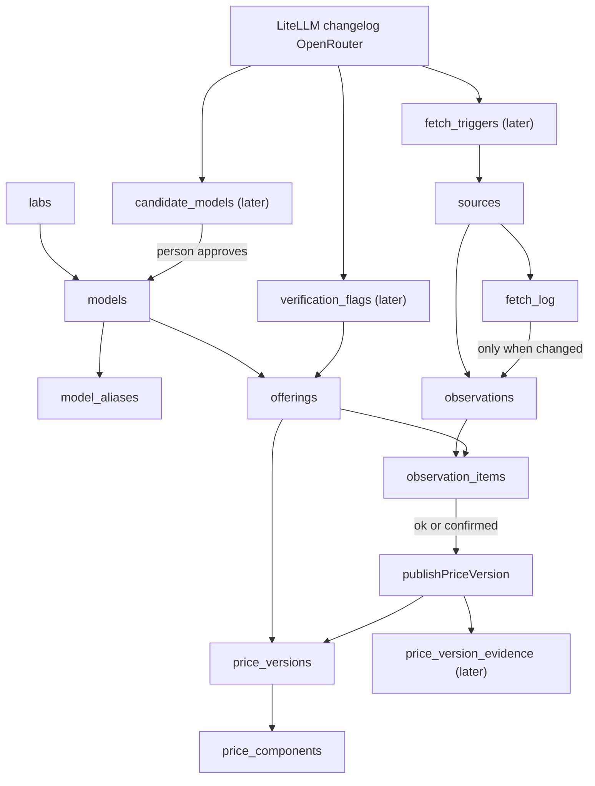

# PriceTrail — Project Brief & Architecture (v3)

An open, source-backed historical pricing database for AI models: how API costs change over time, with evidence for every price.

**Core principle:** Don't track prices. Track pricing _evidence_ and the _periods_ a price was effective for. Every number must trace back to a source. This is non-negotiable, even at MVP scale.

**Second principle:** A price is never written to the database on the strength of our own parser or an LLM extraction alone. It's written when it's either (a) a clean parse of a structured official page that passed sanity checks, (b) an LLM extraction that passed a strict, column-aware grounding check, or (c) a human approved it in the review queue. Aggregator data (LiteLLM, OpenRouter) and feeds (changelogs, commit feeds) are _signals that something may have changed_, never a source of truth we publish directly.

**Third principle (new in v3):** Be honest about precision. We usually know a price changed _between two observations_, not at an exact instant. The data model stores what we know (a bracket, plus an announced date when a source gives one) and the UI says so.

> **Note for AI coding agents working on this repo:** the principles above are the actual product. Exactly one function, `publishPriceVersion()`, may insert into `price_versions` / `price_components`, and it refuses any observation item whose `review_status` is not `ok` or `confirmed`. If you're implementing a feature that would let a number reach those tables any other way, stop and flag it. That is the one invariant this project can't compromise on. A CI test enforces it (see "Enforcing the invariant").

---

## The three-tier pipeline

```
signals (feeds, aggregators)  ──►  fetch_triggers  ──┐
scheduled poll (every ~6h)    ──────────────────────┤
                                                     ▼
                                   Tier 2: fetch official source
                                   ├─ hash unchanged → record check, stop
                                   └─ hash changed  → store observation
                                                       ├─ Tier 3: archive (async)
                                                       ├─ extract + sanity check + grounding
                                                       └─ publishPriceVersion() for ok items
                                                          (flagged items → review queue)
```

## How a check is filed

The program is the visit. The tables are where each ending is filed. The poller does not exist yet (build-plan step 23).

A visit always writes `fetch_log`. It writes `observations` and `observation_items` only when the download worked, the mechanical checks passed, and the fingerprint of `parsed_data` is new. `raw_content` and `parsed_data` are both kept on that snapshot. Public pages do not load `raw_content`. Only the evidence view for one price reads it.



The cell check runs only after a snapshot exists, and only for offerings we already track. A model on the page with no offering is not an item. Its numbers stay inside `observations.parsed_data`.



Tables in the database today are `labs`, `models`, `model_aliases`, `offerings`, `price_versions`, `price_components`, `sources`, `fetch_log`, `observations`, and `observation_items`. `fetch_triggers`, `candidate_models`, `verification_flags`, and `price_version_evidence` are not created yet. They are on the diagram so the path is visible. The row picture of the tables that exist is [price-tables.md](price-tables.md).



When something looks wrong, start at the table for that step. A failed download or `parser_suspect` is only a `fetch_log` row, and the page text was not kept. A waiting model is an `observation_items` row with `review_status` `flagged`. A wrong published number starts at `price_versions`, then the item that was allowed to publish, then the snapshot's `raw_content`.

### Tier 1 — Triggers (detection only, never writes a price)

Cheap signals that tell Tier 2 _where to look sooner_. Every signal does one thing: enqueue a row in `fetch_triggers`, or raise a candidate/flag for review. None of them touches `price_versions`, `price_components`, or `observations`.

Signal sources:

- **LiteLLM** `model_prices_and_context_window.json`, plus the GitHub commits Atom feed for that file (a timestamped "something changed in the cost map" signal without diffing the whole JSON ourselves).
- **OpenRouter** `/models` API (the one aggregator that includes prices directly).
- **Provider changelogs / release notes** (RSS or plain pages). A new entry matching pricing-related keywords enqueues a fetch of the official pricing source. These often carry real announcement dates, which feed `announced_on`.
- **Provider `/models` endpoints** (official, authenticated, no prices): the best source for discovering new models.

Diff logic:

- Unrecognized model slug (after alias resolution) → insert into `candidate_models` (status `pending_review`).
- Known model, but an aggregator price disagrees with our current price → insert/update `verification_flags` **and** enqueue a trigger for the official source.
- Changelog / commit-feed hit → enqueue a trigger for the relevant source.

Triggers are idempotent: a duplicate trigger just causes one extra harmless fetch.

### Tier 2 — Verify & detect (the evidence chain; the official page is the real change detector)

Runs on a schedule (every ~6 hours; cheap, it's a handful of HTTP GETs) and whenever `fetch_triggers` has pending rows. The daily-only design from v2 is gone: polling more often just narrows the bracket in which a change is known to have happened.

For each active source:

1. **Fetch** the page. If the page is JS-rendered, prefer fetching the underlying JSON the page loads; fall back to Playwright only when no such JSON exists. The parser is chosen from a map in code, keyed by the source URL.
2. **Parse** into normalized, Zod-validated `parsed_data` (all models on the page):
   - Structured docs table → a hand-written parser, plain code, nothing to distrust.
   - Marketing-style page that resists clean parsing → LLM extraction allowed, but only with the grounding check below.
3. **Sanity-check the parse before trusting any diff.** Expected models present? Prices within a plausible range (e.g. no value changed by >10x without going to review)? Row count not suddenly zero? If it fails, record `parser_suspect` in `fetch_log` and alert. **A parser break is not a price change.** Nothing is diffed or published from a suspect parse.
4. **Hash** `parsed_data` (`content_hash`) and compare it to the latest observation for this source.
   - **Same hash:** write a `fetch_log` row and bump `sources.last_checked_at`. The open price version stays open, so `last_seen_at` stays blank. No new observation, no raw copy stored, no Wayback call.
   - **Different hash:** create an `observations` row (page-level), store `raw_content` and `raw_content_hash`, create one `observation_items` row per tracked offering, and trigger Tier 3. A model with no offering stays inside `parsed_data` only.
5. **Per item:** run grounding (below). Items that pass get `review_status = ok`; items that fail get `flagged`. Then call `publishPriceVersion()` for `ok` items (it opens/closes versions and records the evidence link).

**Grounding check (column-aware):** it is not enough that a number appears near a model name; a $3 cache price would pass as an input price. For every extracted value, the check must locate it in the raw text (or parsed table) _in the same row as the model name and under the header matching the dimension being claimed_. The result (matched snippet, location, or the reason for failure) is stored on the item in `grounding_result`. Structured-table parses get the same check as a cheap assertion.

**Effective dates:** when a change is detected, set `last_seen_at` on the older row to the last fetch that still showed the old price, and set `first_seen_at` on the new row to this fetch. The change sits between those two times. If a changelog or announcement supplies a date, store it as `announced_on` and prefer it for the chart start.

### Tier 3 — Archive (evidence capture, same fetch as Tier 2)

- Runs only when the hash changed (which also keeps us far below Save Page Now rate limits).
- Submit the fetched URL to the Wayback Machine's Save Page Now API → poll for completion → store the archive.org permalink on `observations.archive_url`.
- If the capture fails or times out, that's non-fatal: `observations.raw_content` (with `raw_content_hash` so anyone can verify it) is the fallback proof. The UI says "archive unavailable, using stored copy" instead of hiding the gap.
- Retry failed captures on a later run rather than blocking ingestion.

### The review queue: a real UI page (authenticated)

This isn't a background job with a log file; it's a page the reviewer looks at. It requires auth from day one (simple is fine: GitHub OAuth with an allowlist, or a single secret-protected login), because it can publish prices.

- **Candidate models**: new slugs Tier 1 spotted. Actions: _Approve_ (creates `models` / `offerings` rows, adds aliases, starts tracking) or _Reject_ (dismiss with an optional note so it doesn't resurface every day).
- **Flagged items**: extractions that failed grounding, and verification flags that didn't self-resolve. Shows the extracted values side-by-side with the raw source text they supposedly came from, with the match highlighted (or visibly missing). Actions: _Confirm_ (calls `publishPriceVersion()`, sets `review_status = confirmed`) or _Reject_ (`rejected`, publishes nothing).
- Every decision records `reviewed_by`, `reviewed_at`, and a `review_note`.

**What the public site shows while something is pending:** the last confirmed price plus a banner such as "A possible change is under review." Never silently show stale data, and never show the unreviewed number.

**Corrections are new rows, not edits.** If a published version turns out to be wrong, set `retracted_at` on that row and insert a fix row. `replaces_version_id` on the fix points at the wrong row. Public pages skip a retracted row. A trust view can follow the link. The wrong row stays in the table.

---

## Data model (v3)

```sql
labs (id, name, slug)
  -- The company that released the model. A later host such as Azure is
  -- offerings.platform, not a row in this table.

models (id, lab_id, name, slug, deprecated_at)   -- unique(lab_id, slug)

model_aliases (id, model_id, alias, kind)
  -- kind: 'latest_pointer' | 'dated_snapshot' | 'former_name' | 'aggregator_slug'
  -- Resolves lab aliases and renames to ONE model so a rename never
  -- splits a price history in two. Tier 1 resolves slugs through this table
  -- before deciding something is a new candidate. unique(alias).

offerings (id, model_id, platform, region)
  -- region: nullable, 'global' for MVP (logic ignores it; avoids a later
  -- migration when Azure/Bedrock/Vertex and regional pricing arrive).
  -- unique(model_id, platform, region).

sources (id, url, type, active, last_checked_at)
  -- type: 'official' | 'wayback' | 'aggregator'
  --       | 'announcement' | 'changelog_feed' | 'platform_api'
  -- Which parser runs for a url is a map in the fetcher, not a column.
  -- last_checked_at is the latest check, including one where nothing changed.

-- Operational log of EVERY fetch (including unchanged ones). Cheap, tiny,
-- and the place where "parser broke" and "site blocked us" are visible.
fetch_log (id, source_id, fetched_at, http_status,
           outcome, observation_id, note)
  -- outcome: 'unchanged' | 'changed' | 'parser_suspect' | 'fetch_error'
  -- observation_id: set only when outcome = 'changed', and unique.
  -- One snapshot belongs to one changed row. Many blank links stay allowed.

-- Tier 1 -> Tier 2 work queue.
fetch_triggers (id, source_id, reason, created_at, processed_at)
  -- reason: 'schedule' | 'litellm_commit' | 'changelog_entry'
  --         | 'aggregator_disagreement' | 'manual'

-- Tier 2 + 3 output, PAGE-LEVEL. One row per fetch whose parsed content
-- CHANGED (unchanged fetches live only in fetch_log).
observations (id, source_id, fetched_at, content_hash, raw_content,
              raw_content_hash, parsed_data, archive_url, archive_status)
  -- content_hash is over parsed_data (not raw HTML, which changes for
  -- unrelated reasons: timestamps, ads, A/B markup, causing false diffs).
  -- raw_content and parsed_data are both stored, and only on this row.
  -- Public pages do not load raw_content.
  -- raw_content_hash is over the stored raw text, so the stored copy and
  -- the archive.org copy can be independently verified.
  -- archive_status: 'pending' | 'archived' | 'failed'

-- One tracked offering on one observation. The price JSON lives in
-- observations.parsed_data. This row is the offering, the cell check,
-- and the review stamp.
observation_items (id, observation_id, offering_id, grounding_result,
                   review_status, reviewed_by, reviewed_at, review_note)
  -- review_status: 'ok' | 'flagged' | 'confirmed' | 'rejected'
  -- only 'ok' and 'confirmed' items may be passed to publishPriceVersion()

-- One version = the full set of price components valid for a period.
-- ANY component change fills last_seen_at on the open row and opens a new one.
price_versions (id, offering_id,
                first_seen_at, announced_on, last_seen_at,
                retracted_at, replaces_version_id)
  -- Chart start is announced_on when that is filled, otherwise first_seen_at.
  -- last_seen_at blank means this row is still the current price. Once
  -- filled, it is the last fetch that still showed this price.
  -- The change window is the older row's last_seen_at through the newer
  -- row's first_seen_at. A normal change does not point at its neighbor.
  -- retracted_at filled means public pages skip this row. The row stays.
  -- replaces_version_id is only for a trust view. It points at the
  -- retracted row this fix replaced.

price_components (id, price_version_id, dimension, unit, amount, condition)
  -- dimension: 'input' | 'output' | 'cache_read' | 'cache_write_5m'
  --            | 'cache_write_1h' | (later: 'audio_input', 'image_input',
  --            'cache_storage', 'web_search_call', batch/priority variants...)
  -- unit: 'usd_per_1m_tokens' | 'usd_per_call' | ...
  -- amount: numeric (never float)
  -- condition: nullable jsonb for tiers, e.g. {"min_context_tokens": 200000}
  -- This replaces fixed price columns so new pricing dimensions (context
  -- tiers, audio/image rates, storage fees, per-call tool fees) are new
  -- ROWS, not migrations on the most important table.
  -- unique(price_version_id, dimension, condition)

price_version_evidence (price_version_id, observation_item_id)
  -- composite primary key. Mostly the official-source item; may also hold
  -- a corroborating aggregator reading.

-- Tier 1 output: brand-new model slugs seen in an aggregator or official
-- /models endpoint that we don't track yet (after alias resolution).
candidate_models (id, lab_id, raw_name, raw_slug, source_id,
                  first_seen_at, status, resolved_model_id,
                  reviewed_by, reviewed_at, review_note)
  -- status: 'pending_review' | 'approved' | 'rejected'

-- Tier 1 output: a tracked offering where an aggregator's price disagrees
-- with our current price. Tier 2 tries to resolve these first; only what
-- it can't resolve automatically surfaces in the review UI.
verification_flags (id, offering_id, source_id, detected_at,
                    aggregator_value, our_value, resolved_at, resolution)
  -- resolution: 'reverified_same' | 'price_updated'
  --             | 'human_confirmed' | 'human_rejected'
```

### Enforcing the invariant

- All writes to `price_versions`, `price_components`, and `price_version_evidence` live in one module exporting `publishPriceVersion(observationItemId)`. It reads the item, refuses anything not `ok` / `confirmed`, runs the open/close logic in one transaction, and records the evidence link.
- A CI test greps the codebase (or checks the Drizzle usage) and fails if any other file inserts into those tables. Seed scripts go through the same function.
- Consider a Postgres-level guard later (restricted role / trigger) once the app has more than one writer.

---

## Stack

Reuse what's already known from day-job work, with no new tools to learn mid-project:

- Next.js + TypeScript
- Postgres + Drizzle ORM
- Zod (validate everything at the ingestion boundary)
- Tailwind + shadcn/ui
- Recharts (price-history step chart)
- GitHub Actions (cron every ~6h; it's best-effort and can be delayed, which is fine at this cadence because everything is idempotent)
- Playwright only if a source truly needs a rendered page
- Vercel (hosting)

---

## Scope

**In scope for MVP:**

- 3 providers: OpenAI, Anthropic, Google
- ~10–12 models, hand-picked (no auto-discovery beyond what Tier 1 surfaces for review)
- Global price only (schema supports region, tiers, and extra dimensions; logic fills only the MVP set)
- MVP dimensions: input, output, cache read, cache write (5m / 1h)
- One scheduled ingestion job every ~6h: Tier 1 triggers → Tier 2 verify/detect → Tier 3 archive on change
- Triggers from: LiteLLM commit feed, OpenRouter, provider changelog feeds
- Authenticated review queue
- Three pages: model list, model detail (price + history chart + sources + evidence), review queue
- Pending-change banner on the public pages

**Explicitly out of MVP (defer):**

- Regional/data-residency pricing logic (schema-ready)
- Context-tier, audio/image, batch/priority pricing logic (schema-ready via `price_components.condition`)
- Azure OpenAI / Vertex / Bedrock as platforms (later: Azure Retail Prices API, AWS Price List API, Google Cloud Billing Catalog API as `platform_api` sources: structured JSON, no scraping or LLM needed)
- Public REST API
- npm package
- Cost calculator
- Git-based audit trail (Postgres history is enough)
- Monorepo / package splitting (single Next.js app, plain folders)
- Generic `PricingExtractor` interface (write 2 concrete parsers first; extract an interface once a 3rd makes the pattern obvious)
- More aggregators

**First things after the MVP (highest value):**

1. **Change feed** (RSS + JSON): "Model X input price dropped on this date, here's the proof." The data model already supports it, and it is probably the early hook for users more than browsing.
2. **Wayback backfill** script plus changelog/announcement sources to seed history before launch (history is the differentiator, and day-one history is otherwise empty; backfilled data is coarse and must be labeled `observed`/approximate).
3. Cloud platform APIs (Azure/AWS/Google) as the most trustworthy sources.

Rule of thumb while building: if a decision only matters once you have 6+ providers or regional pricing, don't make it yet. The exception is the shape of the core fact (components, effective-date honesty, model identity), which is why those are in the schema now.

---

## Build order (weekend-sized chunks)

For what to do next, follow [docs/build-plan.md](build-plan.md). This section is the coarse design sequence from before the spike.

0. **Source spike (an evening, before any code).** Fetch the OpenAI, Anthropic, and Google pricing pages by hand and see what you actually get: static HTML table, JS-rendered, bot-protected, or an underlying JSON endpoint? The "structured docs table" assumption may only hold for one provider. Note each source's URL, format, and the plan for it (parser, JSON endpoint, LLM + grounding, or Playwright). Also confirm the LiteLLM commits feed and one provider changelog feed work.
1. **Schema + seed.** Drizzle migrations for the v3 model. Hand-seed ~10 models with today's real prices, **through `publishPriceVersion()`** (so the seed exercises the invariant). Build `/models/[slug]` against seed data before touching any fetching.
2. **Tier 2 + Tier 3, wired together.** OpenAI + Anthropic parsers as plain functions returning Zod-validated normalized JSON; sanity checks; column-aware grounding; hash compare; `fetch_log`; observation + items on change; Wayback submit-on-change storing the permalink. Run manually first, then wire the GitHub Action cron.
3. **Tier 1 + review UI.** LiteLLM/OpenRouter polling and the commit/changelog feeds writing to `fetch_triggers`, `candidate_models`, `verification_flags`; model alias resolution. Build the authenticated review page and wire approve/reject/confirm to the schema, with reviewer and note recorded.
4. **Polish.** Recharts step chart with "changed on or before" labels, evidence expander and sources list, pending-change banner, parser-suspect alerting, deploy.

After this, adding more models/providers is mostly repeating step 2, not new architecture.

---

## Known risks

- **Fetching official pages is the biggest risk.** OpenAI/Google pages may be JS-rendered or bot-protected. Step 0 exists to find this out early.
- **Grounding can pass on the wrong column** unless it's column-aware (it is, in v3).
- **Parser breaks look like price changes** unless sanity checks gate the diff (they do, in v3).
- **GitHub Actions cron is best-effort.** Acceptable here; revisit only if brackets get too wide.
- **Archive.org can fail or rate-limit.** Raw-content fallback plus retry on a later run.
- **Review queue is a single point of human attention.** Keep the pending banner honest so a backlog degrades gracefully instead of silently serving stale data.

---

## Framing / positioning

- Don't claim "the source of truth for AI pricing". The provider is still authoritative for billing.
- Do claim: "an independently maintained historical record of AI model pricing, backed by provider sources and archived evidence, where nothing is published without passing a grounding check or a human review."
- Be explicit about precision: "changed on or before" when only observed, exact dates only when a source announced one.
- Differentiator vs. existing trackers (llm-price-tracker, AI Change Watch, LiteLLM's cost map) and vs. cloud-VM price sites like cloudprice.net (huge catalogs, official machine-readable sources, current price): **evidence-backed, effective-dated LLM pricing with a visible human-in-the-loop safety net**, with a small catalog and deep, verified history.
