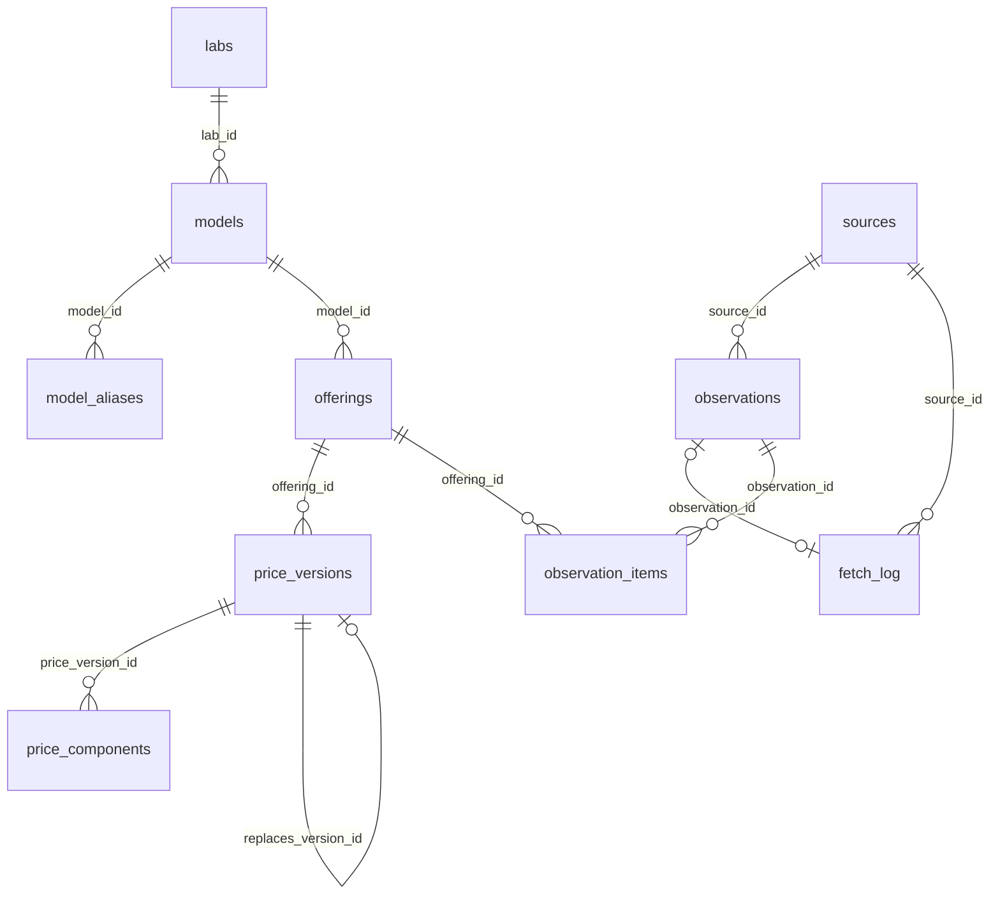

# How the price tables fit together

This file is a picture of the database as it exists today. The rows below are a reading aid. They are not inserted. The real seed is build-plan step 15, and it must go through `publishPriceVersion()`, which does not exist yet. Do not turn this file into SQL and run it. Only that function may write prices.

When a later step adds a table, update this file in that same branch. Add the table to the diagram, and add a filled example that includes every column. Keep the earlier tables and their filled rows. Do not open a second file.

A blank cell means the database stores nothing there. The column is still listed. Leaving a column out is how this picture goes stale.

## Diagram



One lab has many models. One model has many aliases and many offerings. One offering has many price versions. One version has many components. The self-link is only a fix row pointing at a retracted row. A normal price change has no link.

One source is one page. It has many `fetch_log` rows, one per check. It has an `observations` row only when the parsed page changed. One observation has many items, one per tracked offering on that page. A `fetch_log` row points at an observation only when the outcome is `changed`, and only one log row may point at a given observation. A price version does not point at an item. That link is a later table, so it is not on this diagram.

How a visit moves through every table, including tables that are not created yet, is in [docs/architecture.md](architecture.md#how-a-check-is-filed).

## One story: Claude Haiku 4.5

Anthropic sells Claude Haiku 4.5. The page calls it `claude-haiku-4.5`. Another site calls the same model `claude-haiku-4-5`. Those are one model, with an alias, not two histories.

Today's amounts are copied from `tests/fixtures/anthropic-pricing.md`: input `$1`, 5-minute cache write `$1.25`, 1-hour cache write `$2`, cache read `$0.10`, output `$5`, each per million tokens. The older period below uses a made-up past input price, because that fixture is only today's page.

The clock times are part of the illustration. The fixture does not record the hour we fetched the page.

### labs

| id | name | slug |
| --- | --- | --- |
| 1 | Anthropic | anthropic |

One row is one company that released the model. A host such as Azure can sell that model later. The host is `offerings.platform`, not a second lab.

### models

| id | lab_id | name | slug | deprecated_at |
| --- | --- | --- | --- | --- |
| 1 | 1 | Claude Haiku 4.5 | claude-haiku-4.5 |  |

`lab_id` 1 is Anthropic. `deprecated_at` is blank because this model is still current. The slug keeps the dot from the page label. It is not the API id.

### model_aliases

| id | model_id | alias | kind |
| --- | --- | --- | --- |
| 1 | 1 | claude-haiku-4-5 | aggregator_slug |

`model_id` 1 is Claude Haiku 4.5. `claude-haiku-4-5` is the API id used by witnesses such as LiteLLM. `aggregator_slug` means "another site's name for this same model." A lookup by that alias still finds one model.

### offerings

| id | model_id | platform | region |
| --- | --- | --- | --- |
| 1 | 1 | official-api | global |

One offering is one way the model is sold. It stays one row when the price changes. `official-api` means Anthropic's own API. `global` means we are not tracking a region yet. Region is never blank, so two "no region" rows cannot both exist.

## The page behind the 2 June price

The price rows below say we last saw the old price on 20 May and first saw the new price on 2 June. These rows are the checks behind that story. They are still a reading aid. They are not inserted.

A source is the page. The lab row is the company. They are not the same thing.

### sources

| id | url | type | active | last_checked_at |
| --- | --- | --- | --- | --- |
| 1 | https://platform.claude.com/docs/en/about-claude/pricing.md | official | true | 2026-06-02T16:00:00Z |

`url` is the Anthropic pricing page. `official` means the vendor's live pricing page. It is not an archive and not a witness. `active` true means we still check it. `last_checked_at` is the latest check, 2 June. The parser for this URL is chosen in code when the fetcher exists. It is not a column on this row.

### observations

| id | source_id | fetched_at | content_hash | raw_content | raw_content_hash | parsed_data | archive_url | archive_status |
| --- | --- | --- | --- | --- | --- | --- | --- | --- |
| 1 | 1 | 2026-06-02T16:00:00Z | example-parsed-hash | Claude Haiku 4.5 base input $1 / MTok | example-raw-hash | [{"provider":"anthropic","modelName":"Claude Haiku 4.5","modelSlug":"claude-haiku-4.5","dimension":"input","usdPer1M":"1","source":"official"}] |  | pending |

This row exists because the parsed page changed on 2 June. The 20 May check does not get an observation. `fetched_at` is the same clock time as version 2's `first_seen_at`. There is still no foreign key between those two tables. The times match in this picture only.

`content_hash` is a label for the hash of `parsed_data`. `raw_content_hash` is a label for the hash of the stored page text. Both strings are made up for this picture. They are not computed from the fixture. `raw_content` is one stand-in line, not the fixture file.

`parsed_data` is a tiny JSON array with only the current Haiku input price, `$1` per million tokens, and no tier. The real page has more prices. This cell is only big enough to show the shape. `source` inside that JSON means the number came from the official page. It is not `sources.id`.

`archive_url` is blank. `archive_status` is `pending`, so Wayback has not stored a permalink yet.

### observation_items

| id | observation_id | offering_id | grounding_result | review_status | reviewed_by | reviewed_at | review_note |
| --- | --- | --- | --- | --- | --- | --- | --- |
| 1 | 1 | 1 |  | ok |  |  |  |

One item is offering 1 on observation 1. The Haiku input price lives once, in observation 1's `parsed_data`. `grounding_result` is blank because this step does not define that JSON yet.

`review_status` is `ok` so you can see a row a later publish function would be allowed to accept. The database default is `flagged` when a writer forgets to set a status. This example sets `ok` on purpose. `reviewed_by`, `reviewed_at`, and `review_note` are blank because no person reviewed it.

An `ok` item still does not insert a price. Only `publishPriceVersion()` can do that, and it does not exist yet.

### fetch_log

| id | source_id | fetched_at | http_status | outcome | observation_id | note |
| --- | --- | --- | --- | --- | --- | --- |
| 1 | 1 | 2026-05-20T16:00:00Z | 200 | unchanged |  |  |
| 2 | 1 | 2026-06-02T16:00:00Z | 200 | changed | 1 |  |

Row 1 is the 20 May check. The page answered HTTP 200 and the parsed content was the same, so `observation_id` is blank. That blank is why version 1 can record `last_seen_at` without a new observation. Row 2 is the 2 June check. The outcome is `changed`, so it must point at observation 1.

`changed` must point at an observation. `unchanged`, `parser_suspect`, and `fetch_error` must not. This picture has no `parser_suspect` row. `note` is blank on both rows.

## How to read a price version

One row is one period of prices for one offering. The dollar amounts are in `price_components`.

| Column | What one value means |
| --- | --- |
| `first_seen_at` | The first time we fetched the page and saw this price. Required. |
| `announced_on` | The day a source said the price starts. Blank when no source named a day. |
| `last_seen_at` | The last fetch that still showed this price. Blank means this row is still the current price. |
| `retracted_at` | When we decided this published row was wrong. Blank means this is a real period. Public pages skip a filled value. |
| `replaces_version_id` | Only on a fix row. The id of the wrong row it replaced. Public pages ignore this column. |

The chart start is `announced_on` when that cell is filled. Otherwise it is the calendar day of `first_seen_at`.

`last_seen_at` is filled when a newer row is added. The value is the last check that still showed this price, not the time the next row was inserted. If the old price was last seen on 20 May and the new price was first seen on 2 June, row 1 stores 20 May. Writing 2 June would hide the gap.

Public history is one filter and a sort. It does not follow a link.

```sql
SELECT *
FROM price_versions
WHERE offering_id = $1
  AND retracted_at IS NULL
ORDER BY COALESCE(announced_on::timestamp, first_seen_at);
```

`COALESCE` means "use the first value that is filled."

The current price adds one more check: `last_seen_at` is blank.

```sql
SELECT *
FROM price_versions
WHERE offering_id = $1
  AND retracted_at IS NULL
  AND last_seen_at IS NULL;
```

There should be one such row per offering. `publishPriceVersion()` (step 13) keeps that true. This file does not write that function.

## Example 1: a normal price change

Offering 1 stays offering 1. Version 1 is the old period. Version 2 is the current period. Nobody announced the day. We last saw the old price on 20 May. We first saw the new price on 2 June. The change happened after 20 May and on or before 2 June.

### price_versions

| id | offering_id | first_seen_at | announced_on | last_seen_at | retracted_at | replaces_version_id |
| --- | --- | --- | --- | --- | --- | --- |
| 1 | 1 | 2026-01-15T16:00:00Z |  | 2026-05-20T16:00:00Z |  |  |
| 2 | 1 | 2026-06-02T16:00:00Z |  |  |  |  |

Version 1 starts on 15 Jan because `announced_on` is blank, so the start is `first_seen_at`. It ends at 20 May. That cell was filled when version 2 was added. Version 2 starts on 2 June. `last_seen_at` is blank, so it is current. `replaces_version_id` is blank because this is a real change, not a fix.

### price_components

| id | price_version_id | dimension | unit | amount | condition |
| --- | --- | --- | --- | --- | --- |
| 1 | 1 | input | usd_per_1m_tokens | 1.25 | {} |
| 2 | 2 | input | usd_per_1m_tokens | 1 | {} |
| 3 | 2 | cache_write_5m | usd_per_1m_tokens | 1.25 | {} |
| 4 | 2 | cache_write_1h | usd_per_1m_tokens | 2 | {} |
| 5 | 2 | cache_read | usd_per_1m_tokens | 0.10 | {} |
| 6 | 2 | output | usd_per_1m_tokens | 5 | {} |

One row is one amount. Version 2 is today's Haiku price from the fixture, split into five rows. Version 1 has only the made-up past input price of `1.25`, so you can see an old period in this table. The other old amounts are left out of this picture on purpose. `{}` means no tier. `usd_per_1m_tokens` means USD per 1 million tokens. `amount` is an exact decimal, not a JavaScript float.

## Example 2: a source names the day

Same checks as example 1, plus a changelog that says the new price starts on 1 June. We still first saw it on 2 June. The chart uses 1 June. `first_seen_at` stays, so we do not pretend we saw the page on 1 June.

### price_versions

| id | offering_id | first_seen_at | announced_on | last_seen_at | retracted_at | replaces_version_id |
| --- | --- | --- | --- | --- | --- | --- |
| 1 | 1 | 2026-01-15T16:00:00Z |  | 2026-05-20T16:00:00Z |  |  |
| 2 | 1 | 2026-06-02T16:00:00Z | 2026-06-01 |  |  |  |

The site can say "announced for 1 June; first seen on 2 June." The gap from the older row is still 20 May to 2 June.

## Example 3: a published mistake

The wrong price stays in the table. A new version points at it for a trust page. These amounts are made up. They are not the fixture.

We published input `0.80`. The page said `1`. We do not edit the `0.80` row. We set `retracted_at` on it, and we add version 5 with the right amount. The public chart skips version 4 because `retracted_at` is filled. It does not read `replaces_version_id`.

Version 4's `last_seen_at` stays blank. We never saw `0.80` on the page, so there is no last sighting to store.

### price_versions

| id | offering_id | first_seen_at | announced_on | last_seen_at | retracted_at | replaces_version_id |
| --- | --- | --- | --- | --- | --- | --- |
| 4 | 1 | 2026-06-02T16:00:00Z |  |  | 2026-06-03T16:00:00Z |  |
| 5 | 1 | 2026-06-02T16:00:00Z |  |  |  | 4 |

Both rows share `first_seen_at` because the fix is the same period, not a later price. Version 5 is current: `retracted_at` is blank and `last_seen_at` is blank.

### price_components

| id | price_version_id | dimension | unit | amount | condition |
| --- | --- | --- | --- | --- | --- |
| 9 | 4 | input | usd_per_1m_tokens | 0.80 | {} |
| 10 | 5 | input | usd_per_1m_tokens | 1 | {} |

`0.80` is the wrong published input price. `1` is the corrected one. The public history query returns version 5 only.

## A tier is a second row, not a second column

This picture is not on the Claude Haiku 4.5 page. It shows the shape. Version 3 belongs to the same offering. The two input amounts are made up.

### price_versions

| id | offering_id | first_seen_at | announced_on | last_seen_at | retracted_at | replaces_version_id |
| --- | --- | --- | --- | --- | --- | --- |
| 3 | 1 | 2026-06-02T16:00:00Z |  |  |  |  |

### price_components

| id | price_version_id | dimension | unit | amount | condition |
| --- | --- | --- | --- | --- | --- |
| 7 | 3 | input | usd_per_1m_tokens | 1 | {} |
| 8 | 3 | input | usd_per_1m_tokens | 0.50 | {"promptTokensAtMost": 100000} |

Both rows are `input` on version 3. The unique key is version + dimension + condition, so this is allowed. `{}` is the price with no tier. `{"promptTokensAtMost": 100000}` is the price for prompts up to 100,000 tokens. If condition were blank instead of `{}`, Postgres would treat those blanks as different and could store two "no tier" input prices.
